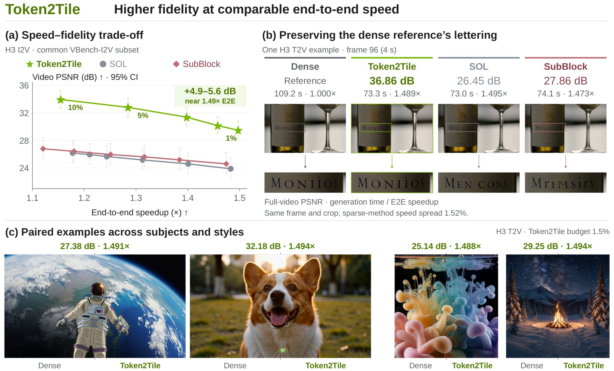

<h1 align="center">Token2Tile</h1>

<p align="center">
  <b>Token-Wise Sparse Attention with Tile Execution<br>through a Low-Rank Space for Video DiTs</b>
</p>

<p align="center">
  Xuecheng Wu<sup>1,2</sup>&nbsp;&nbsp; Aichen Feng<sup>2</sup>&nbsp;&nbsp; Jinyan Chen<sup>2</sup>&nbsp;&nbsp; Qingjie Zhao<sup>1</sup>&nbsp;&nbsp; Julien Lai<sup>2</sup><br>
  <sup>1</sup>Beijing Institute of Technology&nbsp;&nbsp;&nbsp; <sup>2</sup>NVIDIA
</p>

<p align="center">
  <b>Paper</b> (arXiv link coming soon) &nbsp;·&nbsp;
  <a href="#quick-start"><b>Quick start</b></a> &nbsp;·&nbsp;
  <a href="docs/configuration.md"><b>Configuration</b></a> &nbsp;·&nbsp;
  <a href="token2tile/operator/README.md"><b>Operator</b></a> &nbsp;·&nbsp;
  <a href="#citation"><b>Citation</b></a>
</p>

<p align="center">
  
</p>

Token2Tile is a **training-free sparse attention operator** for video diffusion transformers. It gives a
**1.48-1.54x end-to-end speedup** over dense FlashAttention-3 on MiniMax-H3 and Wan2.1-14B, and at the same speed
stays **4.6-6.8 dB closer to the dense video** than block-sparse attention. No training, no model change.

## Why it works

Sparse attention is most accurate when every query chooses its own keys, but GPU kernels are fast on tiles.
Token2Tile keeps both:

- **Per-query scoring.** Queries and keys are projected into one online rank-32 space fitted to preserve the
  attention logits. Keys are clustered there; every query scores the key clusters with its own vector and keeps the
  best ones up to a token budget.
- **Per-query residual.** Clusters a query does not select still contribute through their centroid and value sum,
  merged with the exact part under one softmax.
- **Tile execution.** Queries that score alike are clustered; a query cluster executes the union of its members'
  selections as exact attention packed into GPU tiles.

## Results

Fidelity to the dense video and request time on 8 H200 GPUs, 50 denoising steps (paper, Table 1).

| Model | Task | Method | PSNR (dB) | SSIM | LPIPS | Time (s) | Speedup |
|---|---|---|---:|---:|---:|---:|---:|
| MiniMax-H3 | T2V | Dense FlashAttention-3 | | | | 109.0 | 1.00x |
| | | SOL | 21.00 | 0.722 | 0.206 | 73.5 | 1.48x |
| | | SubBlock | 21.55 | 0.741 | 0.190 | 74.1 | 1.47x |
| | | **Token2Tile 1.5%** | **27.83** | **0.875** | **0.085** | 73.0 | **1.49x** |
| MiniMax-H3 | I2V | Dense FlashAttention-3 | | | | 114.5 | 1.00x |
| | | SOL | 24.03 | 0.803 | 0.120 | 77.0 | 1.49x |
| | | SubBlock | 24.88 | 0.825 | 0.106 | 77.5 | 1.48x |
| | | **Token2Tile 1.25%** | **30.37** | **0.914** | **0.052** | 77.5 | 1.48x |
| Wan2.1-14B | T2V | Dense FlashAttention-3 | | | | 136.0 | 1.00x |
| | | SOL | 22.70 | 0.800 | 0.137 | 96.0 | 1.42x |
| | | **Token2Tile 2.5%** | **27.48** | **0.899** | **0.064** | 88.4 | **1.54x** |
| Wan2.1-14B | I2V | Dense FlashAttention-3 | | | | 137.9 | 1.00x |
| | | SOL | 25.63 | 0.836 | 0.100 | 97.7 | 1.41x |
| | | **Token2Tile 2.5%** | **30.26** | **0.910** | **0.054** | 90.9 | **1.52x** |

The configs for every Token2Tile row are in [`configs/`](configs). The paper has the full comparison, kernel
studies and ablations.

## What is in this repository

The attention operator, its CUDA kernels, and the SGLang-Diffusion integration for Wan2.1 and MiniMax-H3, with the
generation configs of the main results.

## Requirements

- NVIDIA Hopper GPUs (H100 / H200 / H20, SM90a). The kernels use Hopper-specific instructions.
- CUDA 13 toolkit with `nvcc`, PyTorch with Triton.
- SGLang at the commit in `integrations/sglang/SGLANG_BASE_COMMIT`, with its diffusion extras.
- For the metrics: `imageio-ffmpeg`, `scikit-image`, `lpips`.

The kernels are fixed to head dimension 128 and 2048 key clusters. They are compiled on first use (a few minutes
once; cached by PyTorch afterwards).

## Install

```bash
git clone https://github.com/ouershua2299/Token2Tile token2tile && cd token2tile
pip install -e .                                   # the token2tile package: operator + kernel sources

git clone https://github.com/sgl-project/sglang ../sglang
git -C ../sglang checkout $(cat integrations/sglang/SGLANG_BASE_COMMIT)
integrations/sglang/apply.sh ../sglang             # registers the t2t_attn attention backend
pip install -e "../sglang/python[diffusion]"
```

`apply.sh` applies a small patch (backend registration, per-step metadata) and copies
`integrations/sglang/backend/t2t_attn.py` into the checkout. The backend finds the operator through the installed
`token2tile` package; set `T2T_OPERATOR_DIR=<path>/token2tile/operator` to use a source tree without installing it.

## Quick start

Generation runs through a small session harness that loads the model once and generates a list of requests. Run
from the repository root:

```bash
# MiniMax-H3 text-to-video, 1.5% budget
python evaluation/session.py examples/h3_t2v.json

# dense FlashAttention-3 reference with the same prompt and seed
python evaluation/session.py examples/h3_t2v_dense.json

# fidelity of the Token2Tile video against the dense one
python evaluation/metrics.py pair \
    runs/h3_t2v_dense/lion_s0/video.mp4 runs/h3_t2v_t2t_1p5/lion_s0/video.mp4 metrics.json
```

Each request writes `video.mp4`, `perf.json` (the framework's timing; `total_duration_ms` is the request time) and
the effective `config.json` into its output directory. The harness prints one `CELL_DONE <name> <warm-up s>
<wall s> <request s>` line per request.

Other examples: `examples/wan_t2v.json`, `examples/wan_i2v.json`, `examples/h3_i2v.json` (set the image path first).

### Plan format

```json
{
 "arm": "h3_t2v_t2t_1p5",
 "config": "configs/h3/t2t_t2v_1p5.json",
 "cells": [
  {"name": "lion_s0", "prompt": "a lion is roaring in the wild", "seed": 0, "output": "runs/h3_t2v_t2t_1p5/lion_s0"}
 ]
}
```

| Field | Meaning |
|---|---|
| `config` | A generation config from `configs/`. |
| `cells[].name`, `prompt`, `seed`, `output` | One request and its output directory. A finished cell (`DONE` file) is skipped on rerun. |
| `cells[].request_overrides` | Per-request fields. Wan image-to-video: `{"image_path": ...}`. H3 image-to-video: `{"task": "fl2va", "conditions": [{"type": "image", "uri": ..., "role": "keyframe", "frame_index": 0}]}`. |
| `warmup` | Before each timed request the harness runs a short untimed copy of it (`warmup_steps` denoising steps) so that kernel compilation and buffer allocation fall outside the timing. `"none"` disables this except for cells marked `"burnin": true`. |

For timing, compare a Token2Tile run with a dense run of the same prompts on the same node.

## Configs

| Config | Model | Setting |
|---|---|---|
| `configs/h3/dense.json` | MiniMax-H3 | dense FlashAttention-3 |
| `configs/h3/t2t_t2v_1p5.json` | MiniMax-H3 text-to-video | 1.5% budget |
| `configs/h3/t2t_i2v_1p25.json` | MiniMax-H3 image-to-video | 1.25% budget |
| `configs/wan/{t2v,i2v}_dense.json` | Wan2.1-14B | dense FlashAttention-3 |
| `configs/wan/{t2v,i2v}_t2t_2p5.json` | Wan2.1-14B | 2.5% budget |
| `configs/wan/{t2v,i2v}_t2t_5.json` | Wan2.1-14B | 5% budget |

All use 50 denoising steps and 8 GPUs with Ulysses sequence parallelism; the first 12 steps run dense attention and
the structure is rebuilt every 4 steps. H3 generates 10-second 1344x768 video with audio, Wan 81 frames at 1280x720.
The budget is the fraction of key tokens each query selects; after unions the executed share of query-key pairs is
larger. [`docs/configuration.md`](docs/configuration.md) describes every option and how to change the budget.

## Using the operator directly

```python
import sys, token2tile
sys.path.insert(0, token2tile.operator_dir())
from deploy_step import MaskedStepDeploy

# q, k, v: [H, N, 128] fp16 contiguous CUDA tensors of one attention layer (H heads, N tokens)
op = MaskedStepDeploy(H, N, CQ=N // 128, s_frac=0.025, mask_refresh=4)
state = op.init_state(q, k)                   # projections and initial centroids, once per request and layer

op.set_cfg_call(parity=0, key=layer, step=t)  # CFG branch, layer and denoising step of the next call
out = op.step(q, k, v, state)                 # [H, N, 128] fp16, softmax(q k^T / sqrt(128)) v approximated
```

`set_cfg_call` drives structure reuse: a call rebuilds clusters and selections when `mask_refresh` steps have passed
for its layer and reuses them otherwise. Call `op.reset_cfg_reuse()` between requests. The output buffer is reused
by the next call. See [`token2tile/operator/README.md`](token2tile/operator/README.md) for the stages and kernels.

## Repository layout

| Path | Content |
|---|---|
| `token2tile/operator/` | The operator (`deploy_step.py`), Triton helpers, and the CUDA kernels in `kernels/`: `kmeans_maintain` (clustering), `select_union` (per-query selection and union), `tile_attn` (tile attention, residual, merge). |
| `integrations/sglang/` | The `t2t_attn` attention backend for SGLang-Diffusion and the patch that registers it. See [`integrations/sglang/README.md`](integrations/sglang/README.md). |
| `configs/` | Generation configs for MiniMax-H3 and Wan2.1-14B, dense and Token2Tile. |
| `evaluation/` | `session.py` (generation with per-request timing) and `metrics.py` (PSNR / SSIM / LPIPS against the dense video). |
| `examples/` | Example plans for `evaluation/session.py`. |
| `docs/` | Configuration reference. |

## Limitations

- Hopper GPUs only; head dimension 128; non-causal attention; batch size 1 per rank.
- The cluster-score buffer grows with N x 2048 per head, so memory per rank is higher than dense attention.

## Citation

```bibtex
@article{wu2026token2tile,
  title  = {Token2Tile: Token-Wise Sparse Attention with Tile Execution through a Low-Rank Space for Video DiTs},
  author = {Wu, Xuecheng and Feng, Aichen and Chen, Jinyan and Zhao, Qingjie and Lai, Julien},
  year   = {2026}
}
```
